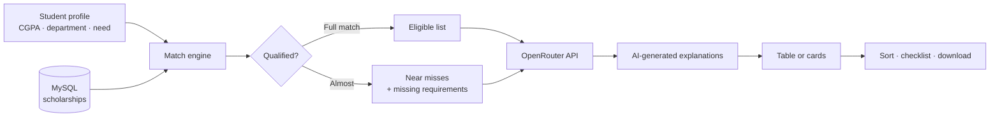

# ScholarSearch

<p align="center">
  <strong>CortexFive</strong> · Beginner AI Hackathon 2026<br>
  PCIU Computer Club · Port City International University, Chattogram
</p>

<p align="center">
  
  
  
  <br>
  
  
  
  
  
</p>

<p align="center">
  <em>Enter your CGPA, department and financial needs — discover scholarships you may qualify for, with an AI-generated explanation for every match.</em>
</p>

**Live Demo:** [ScholarSearch](https://scholarsearchbd.freehosting.dev/?i=1)

---

## Problem

Students spend hours scanning scholarship lists that were never written for their profile. A CSE student with a 3.10 CGPA who also needs financial support should not have to guess which awards they can apply for, which ones they almost qualify for, or what to do next.

Finding relevant scholarships can be confusing because eligibility requirements, minimum CGPA, department restrictions and financial needs vary from one scholarship to another.

## Solution

Scholarship Finder is a web application developed for Track 3 (Personalized Learning & Productivity).

Students enter their CGPA, department and financial-support requirements. The application matches their profile against a local scholarship database and uses an AI model to generate a short explanation for each match.

Students can explore eligible and almost-qualified scholarships, understand missing requirements, follow application checklists, sort results and download their scholarship information.

---

## Features

### Must-have

- [x] Student form for CGPA, department and financial-support needs
- [x] Scholarships loaded from the provided dataset and stored in the database
- [x] Matching based on minimum CGPA and department eligibility, including awards open to all departments
- [x] AI-generated short explanations for scholarship matches
- [x] Results displayed in an organized table or card layout

### Bonus

- [x] Sort scholarships by deadline or award amount
- [x] How-to-apply checklist for each scholarship
- [x] Bangla language support
- [x] Almost-qualified scholarship list with missing requirements
- [x] Download scholarship results

### Also in the data model

- Optional gender information on the student profile to support gender-specific scholarship eligibility
- Need-based scholarship flag for financial-support matching
- Saved searches and ranked results for each search session

---

## How It Works



1. The student submits their CGPA, department and financial-support requirements (optional: gender and language).
2. The matching engine retrieves scholarship information from the local MySQL database — not from a live web scrape.
3. A **full match** meets the CGPA, department (or all-department eligibility), financial-need and gender requirements.
4. An **almost-qualified** match identifies a scholarship where the student is close to meeting the requirements and explains what is missing.
5. The application sends relevant student and scholarship information to the OpenRouter API.
6. The configured AI model generates a short explanation for each scholarship match.
7. Results are ranked and displayed in a table or card layout. Students can sort by deadline or award amount, view application checklists and download results.

---

## Tech Stack

| Layer | Technology |
| --- | --- |
| Backend | PHP |
| Database | MySQL |
| Frontend | HTML, CSS, JavaScript |
| Database Management | phpMyAdmin |
| AI Integration | OpenRouter API |
| Runtime AI Model | Perplexity PPLX Decider Flash v1.3 (Free) |
| Development Tools | Lovable, Anthropic Claude, OpenAI Codex |
| Local Development Environment | XAMPP |

---

## Database

The application uses a relational database to store scholarship information, department eligibility, application steps and student search history.

The provided dataset contains **136 scholarships**, **5 departments**, **103 department links** and **711 application-checklist steps**. Award amounts range from 10,000 to 50,000 BDT. Deadlines are stored as ISO dates.

### Tables

| Table | Purpose |
| --- | --- |
| `departments` | Department code, English name and Bangla name (`CSE`, `EEE`, `CE`, `BBA`, `English`) |
| `scholarships` | Name, provider, minimum CGPA, all-department flag, need-based flag, gender rule, amount (BDT), deadline and description |
| `scholarship_departments` | Many-to-many relationship between scholarships and eligible departments |
| `application_steps` | Ordered how-to-apply checklist; `step_text_bn` is reserved for Bangla |
| `student_searches` | Search information including CGPA, department, financial need, optional gender and language (`en` / `bn`) |
| `search_results` | Per-search matches: `full` or `almost`, `missing_reason`, `ai_reason` and `rank_position` |

`v_scholarships` is a database view that lists each scholarship with its department codes or `All`.

Indexes on `min_cgpa`, `deadline`, `amount_bdt`, department relationships and search results support efficient filtering and sorting.

---

## Setup and Installation

### Prerequisites

- XAMPP
- PHP 8.x or compatible version
- MySQL
- Web Browser
- OpenRouter API key

### 1. Clone the Repository

```bash
git clone https://github.com/rafiqsd85/CortexFive.git
cd CortexFive/ScholarSearch-PHP
```

### 2. Setup Database

1. Start Apache and MySQL from XAMPP.
2. Open phpMyAdmin.
3. Create the required database.
4. Import the provided SQL database file.
5. Update database credentials in the project configuration file.

### 3. Configure OpenRouter API

Add your OpenRouter API key and model configuration to the appropriate configuration file.

Example:

```php
define('OPENROUTER_API_KEY', 'YOUR_OPENROUTER_API_KEY');
define('OPENROUTER_MODEL', 'perplexity/pplx-decider-flash-v1.3:free');
```

**Important:** Never commit real API keys, passwords or secret credentials to GitHub. Keep sensitive configuration files out of version control.

### 4. Run the Application

1. Place the project inside the XAMPP `htdocs` directory.
2. Start Apache and MySQL.
3. Open your browser.
4. Visit:

```text
http://localhost/ScholarSearch-PHP/
```

---

## AI Tools & APIs Used

In accordance with the Beginner AI Hackathon 2026 rulebook, we disclose the AI tools and APIs used during the development of this project.

| AI Tool / API | Purpose |
| --- | --- |
| **Lovable** | UI design, page layouts, student input forms, scholarship result interfaces and frontend scaffolding |
| **Anthropic Claude** | Assistance with scholarship matching logic, eligibility rules, almost-qualified functionality and prompt development |
| **OpenAI Codex** | PHP code generation, database integration, debugging, code improvements and refactoring |
| **OpenRouter API** | Provides API access to the runtime AI model used for generating scholarship explanations |
| **Perplexity PPLX Decider Flash v1.3 (Free)** | Runtime AI model accessed through OpenRouter to generate short explanations for scholarship matches |

### AI Usage Disclosure

- AI tools assisted the team with project planning, UI design, coding and development.
- OpenRouter API connects the application to the configured runtime AI model.
- Scholarship eligibility is determined by predefined matching rules rather than relying solely on AI-generated decisions.
- The AI model generates explanations to help students understand their scholarship matches.
- API credentials are kept private and are not included in the public repository.
- The team reviews and tests the generated code and AI responses.

---

## Team

**Team name:** CortexFive

| Name | Role |
| --- | --- |
| Mohammed Rafiqul Islam | Team Leader |
| Md. Ashikur Rahman | Member |
| Arnob Roy | Member |
| Saidul Karim Ayas | Member |
| Md. Masum | Member |

---

## Hackathon

Built for the **Beginner AI Hackathon 2026**, organized by the [PCIU Computer Club](https://www.pciucomputerclub.com), Port City International University, Chattogram.

- **Theme:** AI for Education
- **Track:** Track 3 — Personalized Learning & Productivity
- **Build window:** 24 November 2026, 8:00 PM – 25 November 2026, 6:00 PM (Bangladesh time)

---

## License

This project is released under the [MIT License](LICENSE). Teams keep ownership of their code and ideas. The PCIU Computer Club and Port City International University may showcase the project for promotional and educational use, as stated in the official rulebook.
